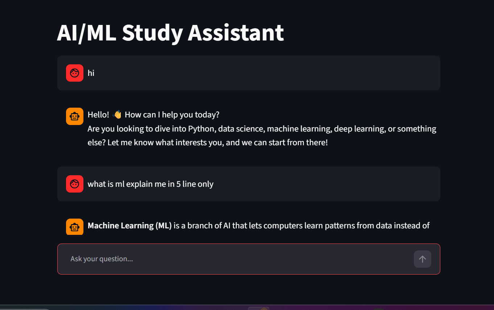
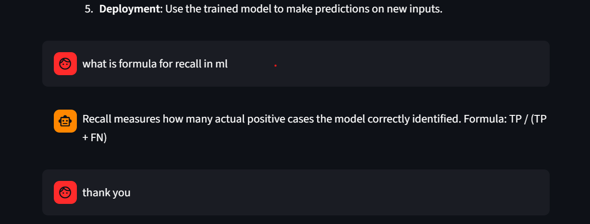

AI/ML Study Assistant 🤖

A simple AI/ML Study Assistant chatbot built using Python, Streamlit, and the Groq API. It helps beginners understand programming and AI/ML concepts through easy-to-understand explanations.

Features
AI-powered answers: Uses the Groq API to answer questions.
Local Answers: Provides predefined answers for common questions without calling the API.
Conversation Memory: Reuses previous answers for repeated questions.
Source Tracking: Displays whether an answer came from Memory, Local Answers, or the Groq API.
Beginner-friendly learning: Supports questions about Python, Data Science, Machine Learning, Deep Learning, and Generative AI.

## Screenshots

### Chatbot Interface

## Screenshots

  
  

